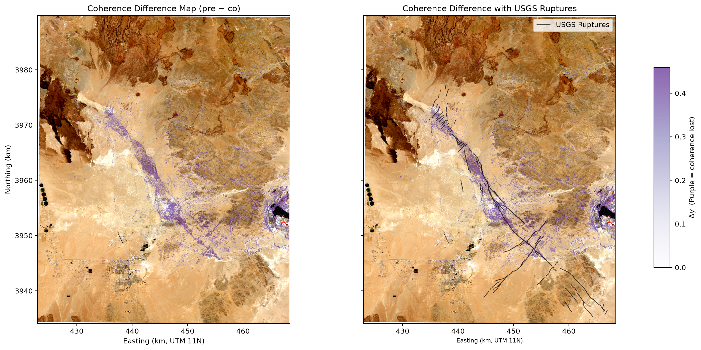
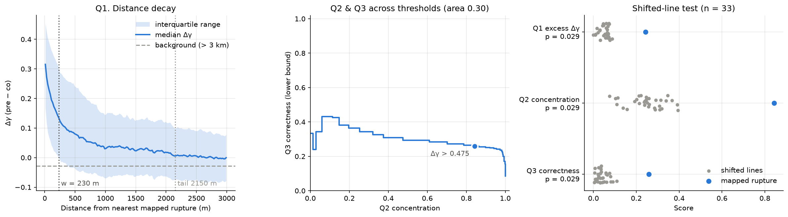
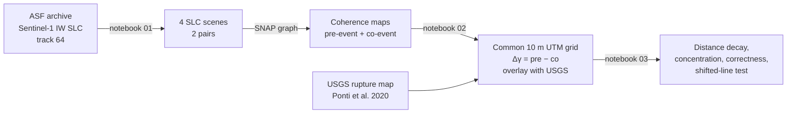
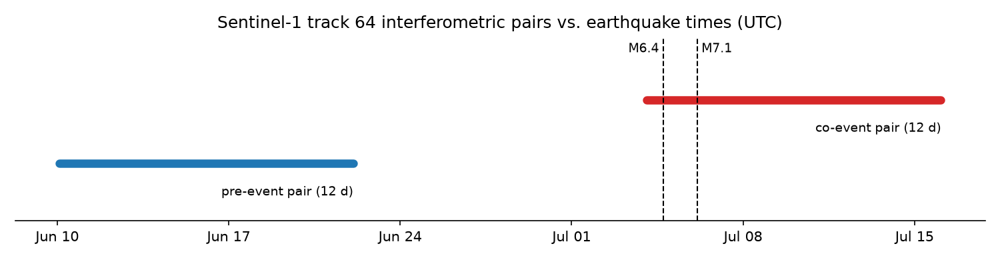

# Mapping the 2019 Ridgecrest Surface Rupture with InSAR Coherence Change Detection

Detecting earthquake surface ruptures from **Sentinel-1 radar coherence loss**. The method was published for the 2003 Bam, Iran earthquake (Fielding et al., 2005). Here I apply it to the 2019 **M6.4 and M7.1 Ridgecrest, California** sequence and test the result statistically against the USGS rupture map.



## Summary

Interferometric coherence measures how stable the radar echo of the ground is between two satellite passes. Coherence over 12 days is normally high but ground that ruptures or cracks in an earthquake loses it. I computed coherence for a **pre-event** pair and a **co-event** pair of Sentinel-1 images in ESA SNAP, then subtracted them in Python. The difference cancels background decorrelation and leaves the event signal. The remaining coherence loss is compared with the USGS rupture traces (Ponti et al., 2020) in three ways to determine what proportion of the decorrelation occurs near the USGS rupture lines, how much of the mapped USGS rupture is covered by coherence loss, and does the degree of decorrelation increase closer to these lines. Each score is tested against randomly shifted copies of the rupture map to determine if the results are due to random chance.

**Key results** (notebook 03, all 196 USGS features, tolerance *w* = 230 m, threshold Δγ > 0.475)

| Question | Mapped rupture | Shifted copies (median) |
|---|---|---|
| Q1 distance decay: median Δγ within *w* above background | 0.24 | 0.06 |
| Q2 concentration: share of mapped rupture with detected coherence loss within *w* | 84% | 25% |
| Q3 correctness: share of detected pixels within *w* of a mapped trace (lower bound) | 26% | 3% |

- Coherence loss halves within **230 m** of the mapped traces (the rupture itself) and falls to 10% at about **2.2 km** (the zone of distributed cracking and shaking damage).
- 109 of the 160 km of mapped rupture falls inside the processed swath. The rest is outside the data and does not count against the scores.
- The mapped rupture outscores all 33 shifted copies on every measure (p = 0.029, the smallest value the test can return).
- Correctness is a lower bound: unmapped cracking and unrelated decorrelation, such as mining at Searles Lake, count against it.



## Background

Fielding et al. (2005) noticed that the interferometric correlation map, often treated as a by-product of InSAR processing, recorded the Bam surface rupture and building damage in detail. Phase-based InSAR fails exactly there, because the ground is too disrupted to unwrap. This makes coherence differencing useful for **rapid rupture mapping** and **change detection**. It only needs data that is routinely acquired, and it complements an InSAR dataset, picking up where the interferometric phase breaks down.

The Ridgecrest sequence is used as a test case:
- **M6.4**, 2019-07-04 17:33 UTC: a NE–SW left-lateral rupture
- **M7.1**, 2019-07-06 03:19 UTC (July 5 local time): about 50 km of NW–SE right-lateral rupture
- Arid, sparsely vegetated terrain with high background coherence
- Detailed independent ground truth from USGS and CGS mapping

## Workflow



| Step | Tool | Where |
|---|---|---|
| 1. Search and download Sentinel-1 SLCs | Python, `asf_search` | [`notebooks/01_search_download_sentinel1.ipynb`](notebooks/01_search_download_sentinel1.ipynb) |
| 2. Coregistration and coherence estimation | ESA SNAP (Graph Builder / `gpt`) | [`snap/README.md`](snap/README.md), [`snap/coherence_graph.xml`](snap/coherence_graph.xml) |
| 3. Common grid, differencing and visual comparison | Python, `rasterio`, `geopandas` | [`notebooks/02_coherence_change_mapping.ipynb`](notebooks/02_coherence_change_mapping.ipynb) |
| 4. Statistical validation against USGS mapping | Python, `scipy`, `geopandas` | [`notebooks/03_validation_vs_usgs.ipynb`](notebooks/03_validation_vs_usgs.ipynb) |

Reusable functions live in [`src/ccd_utils.py`](src/ccd_utils.py).

## Data

| Pair | Reference | Secondary | Baseline |
|---|---|---|---|
| Pre-event | S1A 2019-06-10 01:50 UTC | S1A 2019-06-22 01:50 UTC | 12 days |
| Co-event | S1A 2019-07-04 01:50 UTC | S1A 2019-07-16 01:50 UTC | 12 days |

All scenes are Sentinel-1 IW SLC, VV polarization, ascending relative orbit 64, subswath IW2. Full scene IDs are in notebook 01.



The pre-event pair (2019-06-10 and 2019-06-22) is the baseline before the event. The co-event pair (2019-07-04 and 2019-07-16) has one image before the earthquakes and one after. The July 4 image was acquired about 16 hours **before** the M6.4.

- **Sentinel-1:** Copernicus Sentinel data 2019, retrieved from the [Alaska Satellite Facility](https://search.asf.alaska.edu/)
- **Ground data:** USGS surface rupture mapping, [doi:10.5066/P9BZ5IJ9](https://doi.org/10.5066/P9BZ5IJ9). 132 of the 196 features are mapped from imagery (`Source = PixelTracking`) rather than in the field.
- **Optical background:** Sentinel-2 L2A true colour, 2019-07-18 (notebook 02 overlay only)
- **DEM:** SRTM 3 arc-second, downloaded automatically by SNAP

Raw and processed rasters are not committed, because they are several GB. See [`data/README.md`](data/README.md).

## Methods

1. **Coherence (SNAP).** TOPSAR-Split (IW2, bursts 1–9, VV) → precise orbits → DEM-assisted back-geocoding → Enhanced Spectral Diversity → interferogram with coherence (10 × 3 range × azimuth window, about 40 m on the ground) → deburst → topographic phase removal → terrain correction to 10 m.
2. **Common grid.** Each pair is terrain-corrected separately in WGS84, so the two maps have slightly different pixel grids. Both are resampled (bilinear) onto one 10 m UTM 11N grid covering the AOI, and pixels outside the AOI are masked. Pixel (row, col) is then the same ground in both maps, and distances are in metres.
3. **Change map.** Δγ = γ_pre − γ_co, with positive values meaning coherence was lost. Notebook 02 overlays it on the USGS traces and an optical image.
4. **Validation (notebook 03).** The rupture lines are rasterized, and a distance transform gives each pixel's distance to the nearest trace.
   - **Q1 distance decay:** median Δγ in 20 m distance bins out to 3 km, compared with the background beyond 3 km. The distance at which the excess halves sets the tolerance *w*.
   - **Q2 concentration and Q3 correctness** (Wiedemann et al., 1998): Δγ is median-filtered (5 × 5) and thresholded at values from 0.05 to 0.9. Concentration is the share of rupture length with a detection within *w*. Correctness is the share of detections within *w* of a trace. The operating threshold maximizes their harmonic mean.
   - **Shifted-line test:** the whole rupture map is moved 3, 5 and 7 km in 12 directions and each copy is scored the same way, with pixels within 2*w* of the real traces masked (Harms et al., 2001). p = (1 + number of copies scoring at least as well) / (1 + number of copies) (Phipson & Smyth, 2010).

## Limitations

- Coherence loss is not specific to faulting. Shaking-induced cracking, liquefaction, rockfall and human activity (e.g. Searles Lake mining) also decorrelate the ground.
- The ~40 m coherence window merges narrow, closely spaced fractures.
- Residual temporal decorrelation from wind, rain and vehicle tracks leaves noise in the 12-day pairs.
- One subswath of one ascending track is used, so part of the rupture is outside the data. A descending track would give an independent view.
- The USGS map is most complete along the main traces, so some "false positives" may be real but unmapped cracking. Set `RUPTURE_SOURCE = "pontietal"` in notebook 03 to validate against field-mapped traces only.

## Reproduce

```bash
git clone https://github.com/<your-username>/ridgecrest-insar-coherence-rupture.git
cd ridgecrest-insar-coherence-rupture
conda env create -f environment.yml
conda activate ridgecrest-ccd
export EARTHDATA_TOKEN=...          # NASA Earthdata Login token
# run notebooks/01, then the SNAP graph for each pair, then notebooks/02 and 03
```

SNAP 9 or later is needed for step 2. See [`snap/README.md`](snap/README.md) for running the graph from the command line. Notebooks 02 and 03 expect the SNAP outputs at `data/processed/PreEventCoherence.tif` and `data/processed/PostEventCoherence.tif`.

## References

- Davis, J., & Goadrich, M. (2006). The relationship between precision-recall and ROC curves. *Proceedings of ICML*, 233–240.
- Fielding, E. J., Talebian, M., Rosen, P. A., Nazari, H., Jackson, J. A., Ghorashi, M., & Walker, R. (2005). Surface ruptures and building damage of the 2003 Bam, Iran, earthquake mapped by satellite synthetic aperture radar interferometric correlation. *Journal of Geophysical Research: Solid Earth*, 110. https://doi.org/10.1029/2004JB003299
- Harms, K. E., Condit, R., Hubbell, S. P., & Foster, R. B. (2001). Habitat associations of trees and shrubs in a 50-ha neotropical forest plot. *Journal of Ecology*, 89, 947–959.
- Phipson, B., & Smyth, G. K. (2010). Permutation p-values should never be zero. *Statistical Applications in Genetics and Molecular Biology*, 9(1).
- Ponti, D. J., Pickering, A. J., Blair, J. L., Rosa, C. M., Thomas, K., & Dawson, T. (2020). *Digital datasets documenting surface fault rupture and ground deformation features produced by the Ridgecrest M6.4 and M7.1 earthquake sequence of July 4 and 5, 2019.* U.S. Geological Survey data release. https://doi.org/10.5066/P9BZ5IJ9
- Wiedemann, C., Heipke, C., Mayer, H., & Jamet, O. (1998). Empirical evaluation of automatically extracted road axes. In K. Bowyer & P. J. Phillips (Eds.), *Empirical Evaluation Techniques in Computer Vision* (pp. 172–187). IEEE Computer Society Press.
- California Geological Survey: [2019 Ridgecrest earthquake sequence](https://www.conservation.ca.gov/cgs/earthquakes/ridgecrest)
